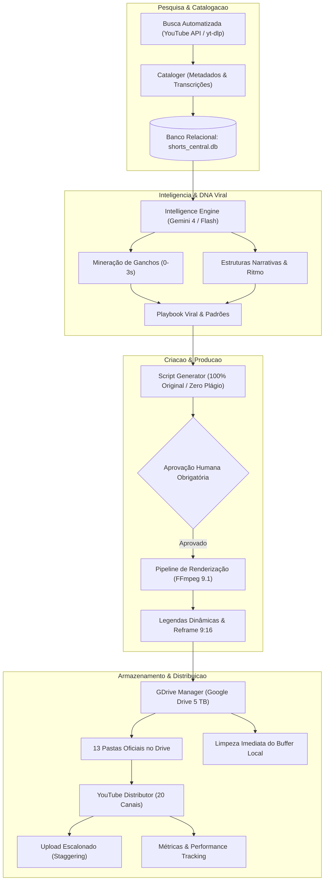

# CENTRAL INTELIGENTE DE YOUTUBE SHORTS — ARQUITETURA DE SISTEMA

## 1. Visão Geral da Arquitetura
A plataforma foi concebida para operar uma rede de aproximadamente **20 canais independentes** no YouTube Shorts, mantendo um banco inicial de **2.000 a 3.000 referências** categorizadas e operando com um armazenamento central em **Google Drive de 5 TB**.

O princípio basilar da engenharia é: **o computador local não é depósito de vídeos**. O computador atua como nó de controle e interface administrativa. Todo material processado é transferido para o Google Drive e o buffer temporário local é eliminado.

---

## 2. Diagrama de Blocos da Solução

---

## 3. Modelo de Dados Relacional (`shorts_central.db`)
O sistema utiliza SQLite com abstração preparada para PostgreSQL, contendo:
* **`video_references`**: Armazena as 3.000 referências (título, canal, duração, views, likes, engajamento, permissão de uso).
* **`categories`**: 15 categorias nativas (Podcasts, Esportes, Humor, Memes, Storytelling, Curiosidades, Tecnologia, etc.).
* **`content_patterns`**: Biblioteca de fórmulas de abertura (0-3s), estruturas narrativas e elementos de retenção.
* **`channels`**: Gerenciamento individual dos 20 canais (nicho, público, tom, estilo de edição, frequência).
* **`scripts`**: Roteiros originais gerados pela IA, com controle de status e aprovação humana obrigatória.
* **`production_pipeline`**: Fila de renderização, links do Drive e rastreamento de etapas.
* **`publications`**: Histórico de publicações por canal, agendamentos e IDs de vídeos postados.
* **`audit_logs`**: Logs detalhados de operações do Drive, YouTube e erros do sistema.

---

## 4. Política de Armazenamento no Google Drive 5 TB
* O acesso é feito via Google Drive API v3 oficial (OAuth 2.0).
* O script cria automaticamente as 13 pastas da `CENTRAL SHORTS`:
  - `00 - Banco de referências`
  - `01 - Vídeos catalogados`
  - `02 - Vídeos autorizados`
  - `03 - Vídeos em análise`
  - `04 - Inteligência e padrões`
  - `05 - Roteiros e ideias`
  - `06 - Produção`
  - `07 - Vídeos finalizados`
  - `08 - Thumbnails e materiais`
  - `09 - Relatórios e métricas`
  - `10 - Canais` (contendo 20 subpastas: Canal 01 até Canal 20)
  - `11 - Arquivos temporários`
  - `12 - Backups e documentação`
* **Limpeza Automática:** Nenhum vídeo permanece no disco local após o upload confirmado no Google Drive.
* **Não-Destruição:** A plataforma possui política estrita de não deletar arquivos do Drive sem confirmação explícita do usuário.
